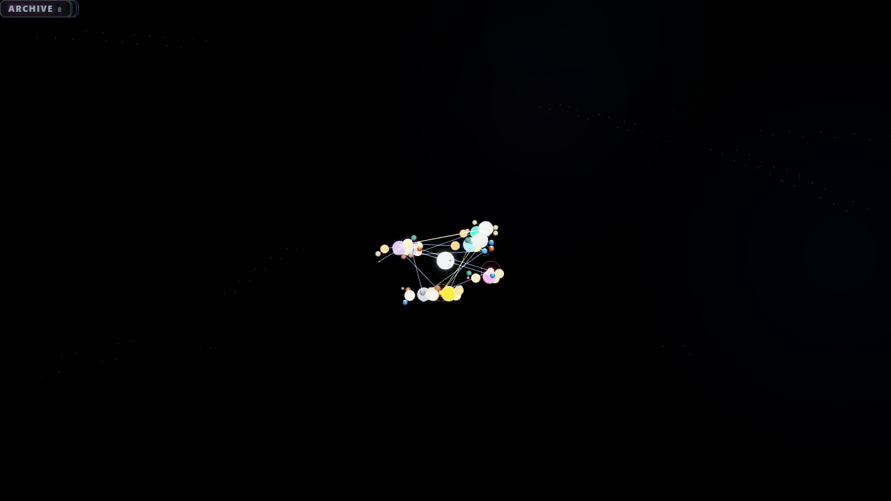

# Kosmos-Oden v0.9.5 (alpha)

**Build:** `kosmos-oden-0.9.5-alpha.1` · **Plugin version:** 0.9.5 ·
**Needs:** Obsidian 1.13.0 or newer · **Status:** alpha, not a qualified
release (see [Honest status](#honest-status)).

Kosmos-Oden is an Obsidian plugin that does three things with the Markdown
notes you already have:

- **Shows them as a universe you can fly through.** Folders become galaxies,
  connected notes become stars and planets, loose notes become asteroids,
  attachments become a distant cloud.
- **Lets you search them**, by the words in them and, if you switch it on, by
  meaning.
- **Lets an AI assistant read the folders you choose**, and nothing else.

Your notes stay ordinary Markdown files. Ordinary viewing is local and
read-only, and a standalone viewer also works without Obsidian or the
internet.



## Start here (for anyone who keeps notes in Obsidian)

You do not need to know anything about governance, GKX or MCP to use any of
this. A few words used below: **MCP** is the standard way an AI assistant
connects to a tool; a **token** is a private key that only lets your own
assistant in; **semantic search** means finding notes by what they mean, not
only by the words they contain.

### 1. Install the alpha

1. Close Obsidian.
2. Unzip `kosmos-oden-0.9.5-alpha.1.zip`. It holds a `kosmos-oden/` folder.
3. Copy that folder into `<your vault>/.obsidian/plugins/kosmos-oden/`,
   replacing the old one if there is one.
4. Start Obsidian and switch on **Kosmos-Oden** under **Settings → Community
   plugins**.
5. Run **Open Kosmos-Oden** from the command palette to fly through your notes.

Full steps, including upgrading from 0.9.0: [docs/v0.9.5/ALPHA-INSTALL.md](docs/v0.9.5/ALPHA-INSTALL.md).

### 2. Bring in and search your notes (Personal Notes)

**Personal Notes** is the profile for everyday notes. They need no special
formatting and no labels. A new installation starts in it with nothing shared
and the connection off.

- **Add notes from another app** walks you through bringing in Google Keep or
  OneNote notes. The conversion itself is done by Obsidian's own **Importer**
  community plugin.
- **Search my notes** (also the search icon in the ribbon) searches your whole
  vault by words. Put an exact phrase in quotes.
- **Optional tags** (off until you turn it on) can add time stamps, permanent
  IDs and "this note replaces that one" links, after showing you every change
  first and saving a backup.

Details: [docs/PERSONAL-NOTES.md](docs/PERSONAL-NOTES.md).

### 3. Turn on search by meaning (optional)

A word search cannot find a note that says the same thing in other words:
"my computer will not start" does not contain "boot". Semantic search can.
It is off until you switch it on, it runs inside Obsidian, and nothing else
needs installing.

1. Open **Settings → Kosmos-Oden → Semantic search**.
2. Switch **Search by meaning** on.
3. Pick an **Embedding model** from the list and press **Download**. The
   models are 24 to 135 MB, and each is published under the MIT or Apache-2.0
   licence. (Or choose **Use my own model files…** and select an ONNX model
   and its tokenizer that you already have.)
4. The index builds in the background; the **Index** line shows progress.
   Search works while it builds.

The index is one SQLite file the plugin writes in its own folder. It holds note
paths and numbers, never note text. The model download is the only network
request, and it carries no note text. Guide, model list and limits:
[docs/v0.9.5/SEMANTIC-SEARCH.md](docs/v0.9.5/SEMANTIC-SEARCH.md).

### 4. Connect an AI assistant (optional)

1. Run the **Connect my AI** command (or find the same windows under
   **Settings → Kosmos-Oden → Agent API (HTTP + MCP)** → Personal Notes).
2. Under **Folders shared with agents**, turn on **Whole vault** or individual
   folders, list anything under **Never share**, and press **Save shared
   folders**. Nothing chosen means nothing is shared.
3. Press **Connect**. The first time, it makes a key (token) for this
   computer.
4. Under Quick Connect press **Copy configuration** for your assistant
   (Claude Code, OpenAI Codex or another MCP client) and paste it there.
5. Press **Test connection** to check.

The assistant can only read; it cannot change, create or delete anything. A
note outside the shared folders looks to it as if it did not exist. The key
stays on this computer. If your assistant runs in the cloud, the notes it reads
are sent to that service. Connecting needs desktop Obsidian and works only
while Obsidian is open.

You can also open `http://127.0.0.1:4816/ui` in a browser on the same computer,
enter the token once, and ask a question yourself. It is a search box that
needs no AI service.

## Governance is an option

Kosmos-Oden also supports **governed vaults**: notes with GKX metadata,
recorded lineage (which note supersedes which), validation by the GKOS-Engine,
and the governed agent tools. They are there for people who want them. **Nobody
has to use them**; the sections above work without any of it. The governed
behaviour is the **Existing** profile; an upgraded installation stays on it
until you switch to Personal Notes, and switching back restores its settings.

Where to read more, further down this page:
[Lineage, time, and GKX](#lineage-time-and-gkx) ·
[Obsidian Agent API and Graphiti](#obsidian-agent-api-and-graphiti) ·
[Human-controlled GKX improvement](#human-controlled-gkx-improvement) ·
[Watch authorized agent activity](#watch-authorized-agent-activity) ·
[Agent API reference](AGENT-API.md) ·
[GKX 2.3 profile](docs/GKX-2.3-PROFILE.md)

## What's new in 0.9.5

- **Search by meaning, inside the plugin.** Off by default. A model list
  limited to MIT and Apache-2.0 licences, or your own model files. Nothing else
  to install: no Python, no Ollama, no server, no account. The index is a
  SQLite file the plugin writes, with no note text in it.
- **Hybrid `ask_librarian`.** Answers a whole question by words always, and by
  meaning when semantic search is on. Each result says how it was found, and
  the answer says whether meaning was used. If semantic search is off, loading
  or failing, you get exactly the word-based answer.
- **The Librarian.** One question instead of keywords. It ranks by words,
  related words and name similarity, and returns the passages that answer,
  numbered steps, web links (forms flagged) and the notes to read next. It
  uses no AI model, no tokens and no network, and the same question over the
  same notes gives the same answer.
- **Map of Content.** The command **Update this folder's map of content
  (deterministic)** writes one index note for a folder, the same bytes for the
  same notes. It replaces only the block between its own markers, saves an
  exact backup first, and refuses a file it did not create.
- **The `/ui` page.** A one-page search box served by the plugin at
  `http://127.0.0.1:4816/ui` that shows the Librarian's answer and says whether
  the search used words and meaning or words only.

Full entries: [CHANGELOG.md](CHANGELOG.md). Design notes:
[docs/v0.9.5/LIBRARIAN-AND-MOC.md](docs/v0.9.5/LIBRARIAN-AND-MOC.md).

## What it can do today

**For everyone**

- Fly through your notes as a 3D universe, in Obsidian or as a standalone
  offline HTML file, with Overview, Focus, Depth, Fly, Search, Chrono, Grow and
  Trailer modes.
- Bring in Google Keep and OneNote notes through the Obsidian Importer, then
  review what arrived.
- Search your whole vault by words (**Search my notes**).
- Search by meaning (optional, off by default).
- Add optional rule-based tags: time stamps, permanent IDs, "supersedes" links.
- Connect an AI assistant that reads only the folders you share. Six read-only
  tools:
  - `vault_overview`: how many notes it can read and what the connection supports
  - `search_notes`: word search over the shared folders
  - `ask_librarian`: answers a whole question with passages, steps, links and related notes
  - `get_note`: the exact text of one note, in pages for long notes
  - `get_related`: notes linked to or from a note, sharing a tag, or close in meaning
  - `get_lineage`: which shared notes supersede which
- Ask the Librarian from a browser at `/ui`.
- Generate a deterministic Map of Content for a folder.
- Optionally sync one vault folder with Nextcloud (off by default, not a
  backup).

**For governed vaults**

- GKX metadata read through the GKOS-Engine, with one canonical lineage graph
  and the GKX 2.3 validating projection.
- Optional read-only Navigation; the Chrono view of which versions were valid
  when.
- The governed (Existing profile) Agent API: graph, search, note, lineage,
  related-note, temporal, diagnostics, assessment, policy, evidence,
  relationship and paginated Graphiti query surfaces over REST and MCP.
- Explicit GKX audit, repair and conversion commands with hash-bound plans and
  byte-exact backups; reviewed, content-assisted enrichment.
- Graph and Graphiti episode export from the command line.
- Watching authorized agent activity in the viewer, with replay.

## Updates

**Since 0.9.0** (version 0.9.5): semantic search, hybrid `ask_librarian`, the
Librarian, the Map-of-Content command and `/ui`; the Personal profile lists six
tools instead of five; `main.js` grows from about 2 MB to about 7.8 MB; three
new exact-pinned build dependencies (`onnxruntime-web`, `sql.js`,
`@huggingface/tokenizers`). Settings, tokens and notes are unchanged on
upgrade; clients that cached the five-tool list should refresh it.

**Since 0.8.4** (the version currently on `main`): everything in 0.9.0 and
0.9.5. 0.9.0 added the Personal Notes profile, guided Google Keep and OneNote
import, **Search my notes**, **Connect my AI** with Quick Connect and a
device-local token, optional rule-based tags, and the Agent API answering older
MCP clients as well as the modern one. It raised the minimum Obsidian version
to 1.13.0 (from 1.11.4), faster existing-profile Agent API retrieval with
identical results, and renderer stability fixes.

The full list, with the changes and security notes of each version, is in
[CHANGELOG.md](CHANGELOG.md).

## Honest status

- **This is an alpha**, not a qualified release.
- **Automated checks pass:** `npm run verify` gave 771 tests passing and 0
  failing at commit `33c8945`, and the five listed embedding models were each
  run for real in a headless Chromium browser (80 of 80 smoke checks).
- **Not yet tried by a person inside Obsidian:** the Semantic search settings,
  the model download, choosing your own model files, and a first index of a
  real vault. Memory use while indexing a large vault was not measured, and the
  hybrid ranking has not been scored on a real vault.
- **The first index is slow.** One CPU thread embeds about 2 to 14 passages per
  second on the build machine, depending on the model; 10,000 passages take
  roughly 12 minutes to more than an hour. It runs in the background, resumes
  if Obsidian closes, and afterwards only changed notes are embedded. Your
  machine will differ.
- **`main.js` is about 7.8 MB** (was about 2 MB), because the two runtimes are
  bundled in it.
- **"Closest in meaning" does not mean "matching".** A question your notes do
  not cover still has a closest note. A note found by meaning alone is labelled
  "found by meaning only", and `confidence` still comes from words.
- Semantic search is meant for desktop; it was not tried on a phone or tablet.
  Four of the five listed models are English; Multilingual E5 Small or your
  own model covers other languages. Only Markdown text is searched: no PDFs,
  images or OCR.
- The 0.9.0 trials that need a real Obsidian, real exports or accounts, and a
  second computer are also still open ([0.9.0 test record](docs/v0.9.0/ALPHA-TEST.md),
  [0.9.5 test record](docs/v0.9.5/ALPHA-TEST.md)).

Known limits in full:
[docs/v0.9.5/KNOWN-LIMITATIONS.md](docs/v0.9.5/KNOWN-LIMITATIONS.md) and
[docs/v0.9.5/SEMANTIC-SEARCH.md](docs/v0.9.5/SEMANTIC-SEARCH.md).

## Earlier version notes

Kept for reference. The 0.9.0 notes are summarised under Updates above; the
full per-version history is in [CHANGELOG.md](CHANGELOG.md).

[Graphiti 0.30.2 and agent identity upgrade report](docs/reviews/2026-09-12-graphiti-runtime-upgrade.md)

[Current Engine development-pin qualification](docs/reviews/2026-10-21-engine-7511233.md)

[Reconciled roadmap and experiment results](docs/plans/GRAPHITI-UPDATE-AND-UPGRADE-2026-09-12.md)
 · [Opt-in exact-source-byte export](docs/reviews/2026-09-13-source-evidence-export.md)

> **Version 0.9.0 (alpha test candidate, now superseded by 0.9.5):** adds the **Personal Notes**
> profile for everyday notes that have no GKX formatting. **Add notes from
> another app** walks you through bringing in Google Keep and OneNote notes
> with the Obsidian Importer community plugin (which does the conversion).
> **Search my notes** is a full-text search over your whole vault.
> **Connect my AI** lets an assistant read only the **Folders shared with
> agents**, from this computer or your local network, with a key that stays
> on this computer. Optional, rule-based tags (time stamps, permanent IDs,
> "supersedes" links) are off until you turn them on. The Agent API answers
> both modern and older MCP clients. A new installation starts in Personal
> Notes with nothing shared; an upgraded one stays on the existing profile.
> Requires Obsidian 1.13.0 or newer; connecting needs desktop Obsidian. Start
> with [Personal Notes](docs/PERSONAL-NOTES.md); release notes, install and
> test steps are in [docs/v0.9.0/](docs/v0.9.0/ALPHA-INSTALL.md).
>
> **Version 0.8.4:** sharper close-ups (a finer close-up mesh tier with extra surface
> detail and relief, closer zoom on a selected body), a lighter per-frame renderer
> (the hidden minimap is no longer painted), and Engine-resolved lineage
> declarations in `get_lineage`.
> Uses the TypeScript GKOS-Engine 2.2.0 development line at exact commit
> `7511233717cd5ab9ce8f6cec76e9623a21e3c728` (Engine main, 2026-10-12).
>
> **Version 0.8.3 candidate:** adds modern MCP 2026-07-28 and preserves Engine
> adapter sensitivity policy. Used Engine commit `777ba170b905952817e364f125c794152f118fa4`. This update preserves the
> existing plugin and standalone workflows, repairs overlapping vault updates,
> and hardens local service connections. It includes no Rust build.
> Automatic MOC writes remain unavailable. See [candidate installation and qualification](docs/REVIEW-0.8.3.md).

The September 12 bugfix update prevents timestamp writes from being scheduled
for startup-discovered notes and prevents slow timestamp writes from retriggering
themselves. A forced Obsidian index rebuild completed with Kosmos enabled and no
Markdown content changes. Connection lines now stay hidden until **All links**
is enabled, while orbital motion continues. See the
[bugfix report and validation limits](docs/reviews/2026-09-12-startup-and-links-bugfix.md).

In the existing profile, agents can opt into note-body discovery with
`search_notes` using `body: true`. (Personal Notes always searches full text.)
It searches the already indexed, readable note snapshot without extra vault reads.
Metadata search remains the default. Body coverage is explicitly partial: at most
64,000 characters per note and 8 million per query; use area/tag filters to narrow
the search. Restricted notes are excluded before their bodies are examined.
The response reports scanned characters and whether those bounds truncated work.

Maintainers can audit a mailbox without changing its files:
`node scripts/audit-mailbox.mjs <mailbox-root> <recipient-id>`.
The audit reports hash/chain/ACK defects; an ACK never proves task completion.

The desktop enrichment review saves immutable proposals and explicit human
decisions separately. Confidence helps filter candidates; it never approves
changes. See [review behavior and host limits](docs/reviews/2026-09-12-proposal-review-upgrade.md).

## Pick a launchpad

| Experience | Best for | What it needs |
|---|---|---|
| **Standalone sky** | Opening a local Markdown folder as one offline visual | `kosmos-oden-stand-alone.html` and a current browser |
| **Obsidian plugin** | Live updates, note navigation, Personal Notes, GKX tools, Agent API, and optional sync | Obsidian 1.13.0+ |
| **Build CLI** | Producing graph JSON or Graphiti episodes in scripts | Node.js 22–24 and a source checkout |

All three use the same pinned Engine semantics rather than inventing separate
parsers for each surface.

Moving from Lite? Follow the [migration checklist](docs/LITE-MIGRATION.md).

## Open the standalone sky

`kosmos-oden-stand-alone.html` is a self-contained offline file: the parser,
graph path, Three.js renderer, controls, and styles are bundled inside it.

1. Open the HTML file in a current browser.
2. Choose **Open Knowledge Folder**.
3. Select a Markdown folder or Obsidian vault.

Chromium-based browsers can grant a reusable read-only directory handle. While
the page stays open, Kosmos rescans and incrementally applies changes. Browsers
without that API can import a one-time folder snapshot instead. The status
panel labels the active mode honestly, and **Forget Folder** removes the saved
handle.

Folder and snapshot viewing do not require Node.js, Python, a web server, a
local service, or network access. Graph and Graphiti exports are assembled in
memory and downloaded only when you ask for them.

## Fly from Obsidian

For a source installation, copy `manifest.json`, `main.js`, and `styles.css`
into `<vault>/.obsidian/plugins/kosmos-oden/`, enable the plugin, and run
**Open Kosmos-Oden**. The view follows Obsidian create, modify, rename, and
delete events without rebuilding the whole vault for an ordinary note edit.

The same renderer works on desktop and mobile. It pauses its render loop while
hidden, adapts geometry and pixel ratio for lower-power devices, and provides
touch controls alongside keyboard and mouse navigation.

See [the community-plugin guide](docs/COMMUNITY-PLUGIN.md) for the established
plugin workflow.

## What your notes become

| In your folder | In the Local Cluster |
|---|---|
| A recognized root MOC | The bright cluster core |
| A top-level folder | A galaxy |
| A well-connected note | A star and solar-system hub |
| Linked descendants | Planets, moons, and moonlets |
| A loose note | An asteroid |
| An image, PDF, or other attachment | An Oort-cloud object |

Star size and spectral color follow the relative weight of each note system,
from cool red M-class stars through hotter blue classes. Planets use the four
broad NASA exoplanet families—terrestrial, super-Earth, Neptunian, and gas
giant—based on their local note-system structure. These are visual metaphors,
not scientific classifications of your ideas.

Kosmos packs each hierarchy, runs separation passes, and reports residual
layout collisions as diagnostics. It does not promise a mathematically perfect
zero-overlap arrangement.

## Ways to explore

- **Overview** surveys the whole cluster.
- **Focus** moves close to a selected body and its neighbors.
- **Depth** dives further into a local system.
- **Fly** enables free-flight controls, with touch pads on mobile.
- **Search** filters the visible universe without rebuilding it.
- **Chrono** projects the graph at a selected validity time.
- **Grow** reveals the cluster in creation order.
- **Trailer** takes a cinematic tour through the largest galaxies.
- **Labels, links, objects, minimap, and legend** can be toggled independently.

**All links** (keyboard **C**) shows connection lines. With it off, membership,
note-chain, and selected/hovered-note connection lines are hidden, including
connection highlights for agent-visited notes. Bodies keep orbiting in either
state. Agent identity markers and traversal effects remain separate.

Right-click or long-press a note to open it in Obsidian. A galaxy backed only
by a folder offers **Expand Folder** instead; it never creates a fake note just
to satisfy the visual metaphor.

## Lineage, time, and GKX

Kosmos reads human-editable GKX metadata through GKOS-Engine
2.2.0 candidate. Declaring
either `supersedes` or `superseded_by` contributes to one canonical lineage
graph. Cycles, ambiguous targets, self-links, multiple successors, and invalid
time order are reported instead of silently becoming trusted edges.

The Chrono view uses retained timestamps and supersession intervals to show
which note versions were valid at a selected time. It does not reconstruct old
file bytes that are no longer present.

Kosmos also exposes the GKX 2.3 validating projection: authored, derived,
suggested, approved, and effective data remain origin-separated. Its
documentation/support assessment is not a truth score and never authorizes
use. This is a bounded product profile, not a claim of full GKOS conformance or
certification.

### Optional read-only Navigation

Engine Navigation is off on upgrade. When enabled, it changes which existing
note is selected as a visual MOC center and recognizes exactly `index`,
`_index`, `readme`, `moc`, and `contents` as built-ins. Former aliases such as
`home`, `map`, and `overview` become noncanonical findings.

Navigation cannot create, rename, rewrite, archive, or delete a note. Kosmos
continues to report that MOC apply is unavailable.

### Experimental managed-MOC groundwork

There is a new workshop off to the side of the observatory—but the doors to
the write machinery are still firmly locked.

On the Navigation Effects integration, Kosmos has implemented
no-write groundwork for a future, separately governed managed-MOC plane:

- `.gkx/**` and `_archive/moc-runs/**` are centrally excluded from the corpus,
  graph, Navigation, enrichment, and agent context;
- versioned settings migrate additively, persist quietly, and keep the Effects
  plane, automatic maintenance, and automatic creation off;
- status reports planner, adapter, authority provider, journal, policy, lease,
  recovery, reconciliation, ownership, and automatic modes independently;
- a browser-safe adapter imports only the framework-neutral Engine Effects
  surface and treats configured infrastructure as capability—not current
  authority;
- policy validation binds exact ID, version, canonical bytes, and lowercase
  SHA-256 digest; and
- authority evaluation requires a credential-bound actor and exact grant for
  the operation, vault, root, object class, sensitivity ceiling, policy, and
  time. Agents cannot approve their own grants; and
- browser-safe ownership/adoption registry and receipt primitives,
  deterministic exact-byte preview/confirmation logic, an in-memory test
  store, and a two-stage trusted adoption-preview modal are present as injected
  components; and
- the Packet C0 host-neutral adapter contract and intentionally unavailable
  Obsidian and standalone/native descriptors report primitive-specific gaps and
  make every host operation unavailable.

These pieces validate inputs and denials; they do not provide a source-effect
path or write an MOC. The adoption components are not registered with the
plugin or standalone runtime and are not backed by a durable host store. The
branch still has no executable or registered Obsidian/standalone effect adapter,
durable
journal/archive/lease, event coordinator, recovery or reconciliation runtime,
self-write suppression, complete operator workflow, rollback/audit workflow,
cross-platform crash evidence, scale evidence, or 24-hour soak. No MOC has
been adopted or written; automatic writes remain unavailable and off. The
[Packet B working-result receipt](docs/navigation-effects/PACKET-B-WORKING-RESULT-20260827.md)
and [Packet C0 working-result receipt](docs/navigation-effects/PACKET-C0-WORKING-RESULT-20260827.md)
record historical local evidence, not runtime or qualification standing.

The dependency is an exact development pin to Engine commit
`7511233717cd5ab9ce8f6cec76e9623a21e3c728`. Its Effects contract says
`integration-only`, targets an unreleased Engine 2.2, labels the Node executor
experimental, and claims no GKOS conformance. See the
[development pin](docs/navigation-effects/DEVELOPMENT-PIN.md),
[initial capability matrix](docs/navigation-effects/CAPABILITY-MATRIX.md), and
[qualification plan](docs/navigation-effects/QUALIFICATION-PLAN.md).

## Watch authorized agent activity

Stable agent identities keep stable, distinct colors across trails, dust,
rocket markers, and labels. The viewer never draws a line segment between two
different agents.

For MCP traffic with optional `clientInfo.name`, the Agent API host mints a
random visual identifier keyed by the cleaned caller name. The renderer
receives this opaque identifier across live, buffered, and replay paths;
it is neither client supplied nor returned to the client. Repeated names keep
their identifier while the bounded identity record remains available. Two
callers whose names clean to the same value share an identifier; a changed
name may receive a different identifier. This is this implementation's display
grouping policy, not a protocol guarantee of caller identity. Modern MCP has
no protocol session or session credential. REST traffic and MCP requests
without client identity use label-only grouping.

This is display continuity only. A stable color, trail, label, or marker does
not authenticate an agent and grants no GKOS authority, capability, approval,
or Effects permission. See the
[host/renderer protocol](docs/RENDERER-PROTOCOL.md) for the exact boundary.

The optional **Traffic Heatmap** brightens recently visited nodes using a
bounded score that fades with elapsed monotonic time. It is off by default and
measures recent visits only—not truth, quality, importance, fuel, cost,
confidence, or authority.

Traversal recording is explicit and in memory. A session stores validated,
redacted event envelopes rather than rendered frames and stops at 5,000 events
or 2 MB, whichever comes first. Replay supports play, pause, seek, restart,
stop, and 1x/2x/5x speeds. Replayed events are marked and never re-enter the
live recording; live events can remain buffered while replay is active.

Nothing is persisted automatically. **Export session** is the deliberate
download boundary.

## Optional standalone-service client

The standalone page includes a read-only client for a compatible, separately
run GKOS local service. It can negotiate capabilities, retrieve an authorized
graph, and receive authorized traversal events over authenticated `fetch()`
streaming.

Only HTTP(S) loopback destinations—`127.0.0.1`, `localhost`, and `::1`—are
accepted. The non-secret address may appear as
`?api=http://127.0.0.1:4814`; credentials are entered in the password field and
are not accepted from the URL. Graph, MCP-availability, event-stream, and
offline-mode states are shown independently.

This repository does **not** bundle an out-of-box standalone service. The
client on main validates `GKOS-LOCAL-SERVICE-1.0.0-draft.1`. A separately
developed Draft.2 runtime is not bundled, released, or automatically compatible
with it. Offline folder and snapshot modes remain fully usable when no service
is present.

## Obsidian Agent API and Graphiti

The plugin can optionally expose a read-only REST and MCP API on loopback port
4816. It is disabled by default, authenticated by default, and answers from the
same Engine-backed index as the viewer. The API includes graph, search, note,
lineage, related-note, temporal, diagnostics, assessment, policy, evidence,
relationship, and paginated Graphiti query surfaces.

The MCP endpoint uses Streamable HTTP in the stateless per-request ("modern")
shape defined by MCP revision `2026-07-28`: no handshake, no session, no GET
stream, with the protocol version and client identity carried per request in
`_meta` and validated against the mirrored HTTP headers. As of 0.9.0, clients
that open with the older `initialize` handshake are answered too, also without
a session, while **Accept older MCP clients** is on (the default):
`2025-11-25`, `2025-06-18` and `2025-03-26` directly over HTTP, and
`2024-11-05` only through the included stdio bridge `kosmos-mcp-stdio.mjs`.
The deprecated HTTP+SSE transport (`/sse`) is not offered. Request,
response, rate, concurrency, and episode-page limits bound resource use.
Sensitivity filtering applies before serialization; invalid explicit labels
fail closed.

LAN mode is a separate opt-in compatibility feature of the Obsidian API. It
requires a token and uses unencrypted HTTP, so use a trusted private network or
a secure tunnel. The standalone-service client described above remains
loopback-only.

In the Personal Notes profile the same listener serves only six read-only
tools (`vault_overview`, `search_notes`, `ask_librarian`, `get_note`,
`get_related`, `get_lineage`) over the shared folders, with exact paged note
reads and its own device-local token.

As of 0.9.5, `ask_librarian` answers a whole question with a hybrid search: by
words always, and by meaning when **Semantic search** is turned on in
Settings. Semantic search runs entirely inside the plugin — pick an MIT or
Apache-2.0 embedding model from the list and press Download, or select your
own ONNX model files; the plugin embeds your notes and writes its own SQLite
index. No other software is needed and no note text leaves the computer. See
[the semantic search guide](docs/v0.9.5/SEMANTIC-SEARCH.md).

See [Agent API](AGENT-API.md) for exact routes, tools, and setup.

## Human-controlled GKX improvement

The Obsidian plugin includes explicit GKX audit, repair, and conversion
commands. A scan produces a content-free, hash-bound plan before any source
change. Applying it requires visible acknowledgements, creates byte-exact local
backups, and rechecks current source bytes so a stale plan cannot quietly
overwrite a newer edit.

Content-assisted enrichment can produce review suggestions for descriptions,
types, tags, and explicitly evidenced relationships. Deterministic selection
runs first; an on-device, private-LAN, or HTTPS model pass is optional and off
by default. Nothing is preselected. A reviewer must resolve every suggestion
before a second, hash-bound apply preview can reach the existing backup and
write boundary.

This is the established enrichment workflow, not the newer immutable
`.gkx/proposals/` and `.gkx/decisions/` subsystem described in roadmap work.
Confidence helps explain a suggestion; it never supplies approval authority.

## Optional Nextcloud WebDAV sync

The Obsidian plugin can synchronize one configured vault folder with
Nextcloud. The feature is disabled by default and keeps its app password in
Obsidian Secret Storage.

Sync compares local SHA-256 values, remote ETags, and the last common state.
When both sides changed, the remote bytes are preserved as a timestamped
conflict copy. Deletion propagation is off by default. `.git/**`, `.trash/**`,
and `.obsidian/**` are excluded by default; `.obsidian` can be opted in, but
Kosmos's credential-bearing plugin data remains forcibly excluded.

HTTPS is required for public hostnames. Plain HTTP is accepted only for literal
private or loopback addresses. Sync is useful, but it is not a backup—keep an
independent, restorable copy of important data.

## Security and privacy at a glance

- Offline folder/snapshot viewing makes no network request unless you
  explicitly choose a networked feature.
- The plugin renderer runs in an opaque-origin sandbox and communicates through
  a closed, versioned message protocol.
- The Obsidian Agent API is off by default, loopback by default, and read-only.
- Semantic search is off by default. Its only network request is the model
  download you start yourself; the index stores no note text.
- Bearer tokens are generated from a CSPRNG, compared in constant time, and
  never logged. Query-token authentication is deprecated and off by default.
- Nextcloud and optional model credentials do not enter synchronized plugin
  data or ordinary logs.
- Graphs, Graphiti episodes, assessments, heat, and replay are projections;
  none replaces canonical source content or grants authority.

Report vulnerabilities privately through GitHub Security Advisories. Do not
include real vault content or live credentials. See [SECURITY.md](SECURITY.md)
and [the threat model](docs/THREAT-MODEL.md).

## Roadmap and feature-branch boundary

The released product and `main` do not include a Navigation Effects dependency
or managed-MOC runtime. The experimental feature branch contains only the
no-write groundwork described above. The following remain roadmap work rather
than working or qualified product behavior:

- the new immutable proposal/decision quarantine and confidence-review system;
- durable host/runtime wiring for managed-MOC ownership/adoption and receipts,
  source writing, archives, durable journal, vault lease, coordinator, recovery,
  reconciliation, self-write suppression, complete trusted operator and
  rollback/audit UI, or automatic maintenance/creation;
- Tauri, native desktop, Docker, or cross-platform standalone-service packages;
- installer signing, macOS notarization, publishing, or a new release label;
- an owner-authorized released Engine 2.2 effects dependency or Rust 3.0
  engine cutover; and
- cross-platform path/crash/durability qualification, scale results, and the
  required 24-hour soak for any Effects host profile.

They are not hidden settings, dormant authority, or production-ready features.

## Build and verify from source

Requirements: Node.js 22–24 and npm 10 or newer.

```bash
npm ci
npm run verify
npm run test:renderer
```

Useful focused commands:

```bash
npm run build:standalone
npm run test:browser
npm run test:visual
npm run check:artifacts
npm run check:renderer-provenance
```

Build a graph or Graphiti export from a shell:

```bash
node kosmos-build.mjs /path/to/vault graph.json
node kosmos-build.mjs /path/to/vault graph.json \
  --episodes graphiti-episodes.json --group-id my-vault
node kosmos-build.mjs /path/to/vault graph.json --watch
```

The release-staging script packages the existing JavaScript/HTML plugin
artifacts with `BUILD-INFO.json` and `SHA256SUMS`; it is not a native installer,
signature, notarization, or publication step.

Test totals are not permanent documentation. Evidence should always name the
exact command, commit, platform, failures, and documented skips.

## Technical map

- [Technical README](TECHNICAL_README.md)—architecture, current capabilities,
  boundaries, scripts, and verification
- [Architecture](docs/ARCHITECTURE.md)—the established module map
- [Renderer protocol](docs/RENDERER-PROTOCOL.md)—the Obsidian host/viewer
  message contract
- [Personal Notes](docs/PERSONAL-NOTES.md)—the 0.9.0 profile for everyday
  notes, and the [0.9.0 alpha documents](docs/v0.9.0/ALPHA-INSTALL.md)
- [Semantic search](docs/v0.9.5/SEMANTIC-SEARCH.md), the
  [Librarian and Map of Content](docs/v0.9.5/LIBRARIAN-AND-MOC.md), the
  [0.9.5 install](docs/v0.9.5/ALPHA-INSTALL.md) and
  [known limitations](docs/v0.9.5/KNOWN-LIMITATIONS.md)
- [MCP protocol eras](docs/MCP-PROTOCOL-ERAS.md) and
  [MCP compatibility](docs/v0.9.0/MCP-COMPATIBILITY.md)—which MCP revisions
  the Agent API speaks on each transport
- [Engine 2.1 compatibility](docs/ENGINE-2.1-COMPATIBILITY.md)—the pinned
  dependency and read-only Navigation boundary
- [GKX 2.3 profile](docs/GKX-2.3-PROFILE.md)—validating projection behavior
- [GKX migration](docs/GKX-MIGRATION.md) and
  [content-assisted enrichment](docs/GKX-ENRICHMENT.md)
- [Agent API](AGENT-API.md)
- [Navigation Effects development pin](docs/navigation-effects/DEVELOPMENT-PIN.md),
  [initial capability matrix](docs/navigation-effects/CAPABILITY-MATRIX.md), and
  [qualification plan](docs/navigation-effects/QUALIFICATION-PLAN.md)
- [Release process](docs/RELEASE-PROCESS.md)

## Origin and licensing

Kosmos-Oden is an independent fork and substantial rebuild of
[H4R7W16/vault-kosmos](https://github.com/H4R7W16/vault-kosmos). See
[ACKNOWLEDGMENTS.md](ACKNOWLEDGMENTS.md) and
[THIRD-PARTY-NOTICES.md](THIRD-PARTY-NOTICES.md) for provenance and bundled
dependency notices.

Project-authored software is Apache-2.0. Project-authored documentation and
original graphics are CC BY 4.0 where declared. Inherited and third-party
assets retain their own licenses. [LICENSE](LICENSE) contains the controlling
licensing structure.

## MCP qualification scope

The Agent API implements modern MCP `2026-07-28` and, while **Accept older MCP
clients** is on, a stateless legacy path for `2025-11-25`, `2025-06-18` and
`2025-03-26` over HTTP, plus `2024-11-05` through the stdio bridge. The
legacy path is new in 0.9.0 and is covered by automated tests (including the
official MCP SDK client 2.4.0) only; no named product client has been
qualified. The separate Engine retrieval client is not upgraded by this candidate;
its service must be qualified independently of the bundled library version.

Kosmos-Oden's read-only viewing behavior does not by itself qualify the GKOS
Viewer/Projection Profile; a profile claim still needs its manifest, report,
and exact evidence. The Standard's
[September 12 clarification](https://github.com/Odenknight/gkos-standard/blob/main/docs/decisions/2026-09-12-implementation-independence.md)
also makes different ownership desirable rather than mandatory for a second
implementation. Different functioning products still need demonstrated
implementation independence; using the Engine through another UI is not that
demonstration by itself. This clarification does not change the plugin's
qualification requirements.


### Agent names and presence

Set `params._meta["io.modelcontextprotocol/clientInfo"]` to
`{"name":"Codex Game Research","version":"1.0"}` on every MCP request to
display a designated name. Names retain spaces, are limited to 80 characters,
and are self-reported labels, not authorization. Use distinct names for distinct
agents.

In the existing profile every tool also accepts an optional `agent_name`
argument (the Personal Notes tools do not), so an agent can name
its ship even when its host controls client metadata. For example:
`get_note({"path":"Game_Dev/Research Game Styles.md","agent_name":"Codex Game Research"})`.
Send the same name on each call. It overrides the transport label for that call.

Traversal segments remain at full brightness for 30 seconds, then fade over five
seconds, independently of subsequent searches.
History is bounded to 4,096 segments; at that limit new segments are omitted
until older ones expire. Markers begin a 30-second fade after two minutes
without traversal activity or a named MCP `ping`. Stateless MCP cannot detect
a disconnected client directly: idle clients can send `ping` every 60 seconds
with the same metadata to retain their last visited marker.

When a UID belongs to multiple readable notes, supply the exact vault-relative
path. UID-only calls reject ambiguity instead of silently choosing a note.
Notes without a UID can also be queried using their path.
