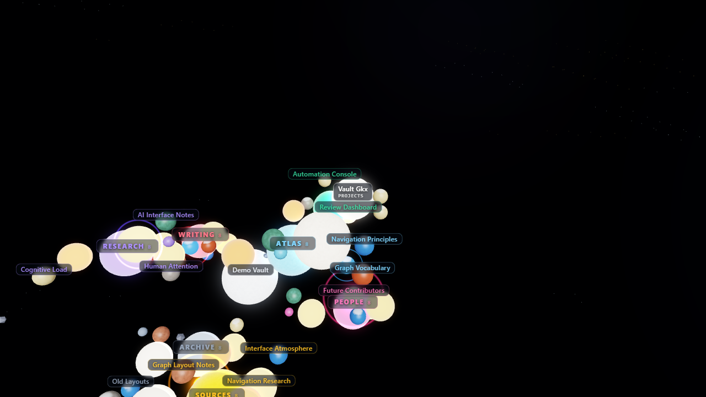
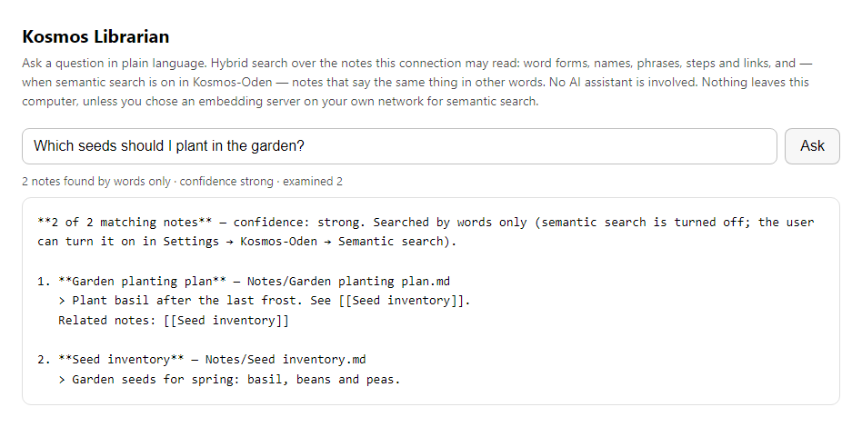
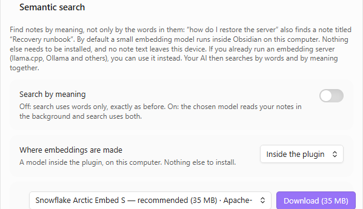
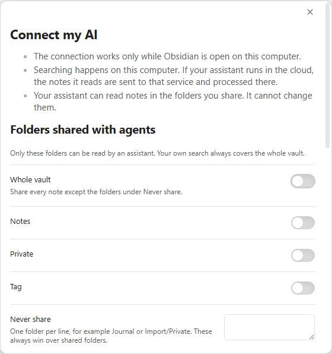
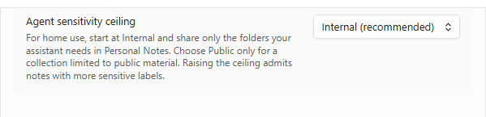
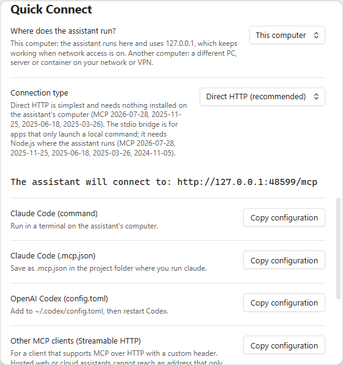
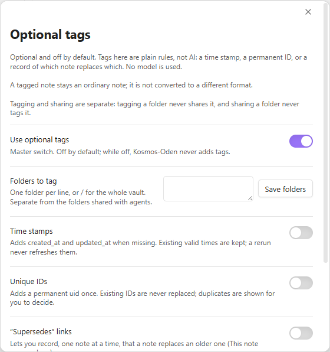
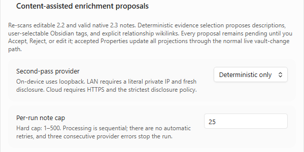
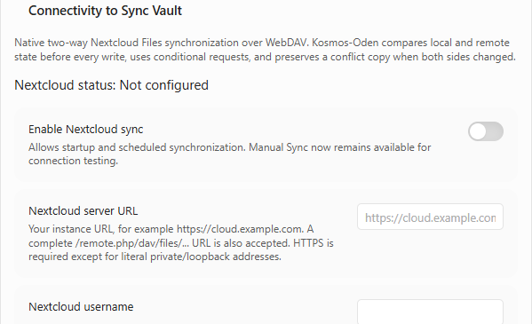

# Kosmos-Oden

Kosmos-Oden helps you find your way back to what you wrote in Obsidian. Open your vault as a sky of connected notes, follow a link, or ask the Librarian a question such as “Which seeds did I plan to plant?” It points you to passages you can open and check. Your notes stay ordinary Markdown.

An AI assistant can use the same library. For example, you can share a garden project with an assistant so it can find last spring’s planting list, while keeping your journal outside its reach. You choose the folders. Sharing starts off, and the assistant’s tools are read-only.

## Quick installation

1. Use Obsidian **1.13.0 or newer**. Close Obsidian and download the [0.9.5 plugin ZIP](https://github.com/Odenknight/Kosmos-Oden/releases/download/0.9.5/kosmos-oden-0.9.5.zip). A [SHA-256 checksum](https://github.com/Odenknight/Kosmos-Oden/releases/download/0.9.5/kosmos-oden-0.9.5.zip.sha256) is available.
2. Extract the ZIP. Copy the files **inside** its `kosmos-oden` folder directly into `<your vault>/.obsidian/plugins/kosmos-oden/`. Create that folder if needed. On upgrade, keep your existing `data.json`.
3. Reopen Obsidian. Under **Settings → Community plugins**, enable **Kosmos-Oden**. Open the command palette and run **Open Kosmos-Oden** to see the sky or **Search my notes** to look something up.

For a manual install, the three base files are [main.js](https://github.com/Odenknight/Kosmos-Oden/releases/download/0.9.5/main.js), [manifest.json](https://github.com/Odenknight/Kosmos-Oden/releases/download/0.9.5/manifest.json) and [styles.css](https://github.com/Odenknight/Kosmos-Oden/releases/download/0.9.5/styles.css). Clients using the local stdio bridge also need [kosmos-mcp-stdio.mjs](https://github.com/Odenknight/Kosmos-Oden/releases/download/0.9.5/kosmos-mcp-stdio.mjs) in that folder. To explore a folder without installing the plugin, open the [offline HTML viewer](https://github.com/Odenknight/Kosmos-Oden/releases/download/0.9.5/kosmos-oden-stand-alone.html) and select **Open Knowledge Folder**.

## Find your way around

Open the **command palette** for everyday actions. Open **Settings → Kosmos-Oden** to configure **Agent API (HTTP + MCP)**, **GKOS Note Formatting**, **Quick Connect MCP**, or **Connectivity to Sync Vault**.

### Explore the sky

Run **Open Kosmos-Oden** and select a star to focus on a note and its connections. Follow a link to see the surrounding notes. Where notes record that one version replaces another, the lineage view lets you trace that history. For a written index, open a note and run **Update this folder’s map of content (deterministic)**. It maintains a list of links in that folder’s index. [Viewer controls and folder workflows](USER-GUIDE.md)

### Find a passage by words or meaning

Use **Search my notes** for exact words or a quoted phrase across your own vault. If its tab opens blank on Windows, use Obsidian’s built-in **Search** for word lookup. An assistant can ask the **Librarian** a whole question and receive ranked notes, excerpts and links. Check the source passage, especially when several notes look plausible. To bring in an old notebook first, **Add notes from another app** guides you through Obsidian Importer for Google Keep or OneNote. [Personal Notes guide](docs/PERSONAL-NOTES.md) · [Observed display issue](docs/v0.9.5/KNOWN-LIMITATIONS.md#search-my-notes-on-windows)

For a question like “How do I get my server back?” when the note is titled “Recovery runbook,” open **Agent API (HTTP + MCP) → Semantic search**. Choose a model, press **Download**, and enable **Search by meaning**. The built-in option downloads model files from Hugging Face on request and indexes notes on this device. If you choose your own local or LAN embedding server, it receives passages and questions. The Librarian can use meaning alongside words as the index fills. Sharing rules still apply. [Models, indexing and server setup](docs/v0.9.5/SEMANTIC-SEARCH.md)

### Choose what an assistant may read

**Personal Notes** is the profile for everyday Markdown. On a fresh install the connection is off and the folder list is empty. In **Connect my AI**, select only folders the assistant needs and put exceptions such as `Journal` in **Never share**. **Existing (governed Agent API)** is the other profile, for vaults that use GKX properties and policy. [Profile and folder rules](docs/PERSONAL-NOTES.md)

**Personal** names a profile. **Public** through **Secret** are the sensitivity levels. The **Agent sensitivity ceiling** is the highest level an assistant may read. For example, an Internal ceiling admits Public and Internal notes. The examples are suggestions for labeling your own notes.

| Level | Example or practical use |
| --- | --- |
| Public | Published instructions you would give anyone. |
| Internal | Ordinary household or team notes. **Start here for home use.** |
| Restricted | A project shared with a smaller group. |
| Confidential | Private agreements or sensitive business information. |
| Regulated | Records subject to special handling rules. |
| PHI | Protected health information. |
| Secret | Your most sensitive material. This ceiling admits every recognized level within the applicable scope. |

In **Personal Notes**, an **unlabeled note in a shared folder is readable even at Public**. Use folder exclusions for anything that must stay private. In the **governed** profile, **Default sensitivity** classifies unlabeled notes and defaults to **Secret**. Leave that default in place if you want unlabeled governed notes withheld at the normal **Internal** ceiling. [Technical access rules](TECHNICAL_README.md#profiles-and-sensitivity)

### Connect an assistant through MCP

MCP is the protocol an assistant uses to ask Kosmos for notes. On desktop, open **Connect my AI**, choose the folders, leave **Localhost only** selected for a client on this computer, and press **Connect**. In **Quick Connect**, select your client, copy its configuration and use **Test connection**. Keep the bearer token private. A cloud assistant receives any note content its client reads. **LAN** makes the listener reachable on your network over plain HTTP. The listener runs while Obsidian is open. [MCP clients, tools and troubleshooting](AGENT-API.md)

### Add tags by rule or review an AI suggestion

**Optional tags** is the simple, deterministic route. Choose a folder and preview missing timestamps or permanent IDs. You can also explicitly record that one note supersedes another. Select the changes to apply. Kosmos backs up affected notes and skips notes that changed after preview. Tagging a folder does not share it. [Optional tagging](docs/PERSONAL-NOTES.md#optional-tags)

For governed GKX notes, open **GKOS Note Formatting → Content-assisted enrichment proposals**. Start with **Deterministic only**, or select an on-device, LAN or cloud model for a second pass. It proposes descriptions, topic tags and relationship links from excerpts. You review the proposals before applying changes. LAN and cloud runs disclose their destination and require confirmation. The cloud ceiling defaults to Public. [Proposal review and data limits](docs/GKX-ENRICHMENT.md)

### Sync with Nextcloud

Open **Connectivity to Sync Vault**, enter your Nextcloud URL, username, app password and remote vault folder, then test the connection before choosing **Sync now**, startup sync or a schedule. The app password goes into Obsidian SecretStorage. By default, a file missing on one side is restored from the other. **Propagate deletions** changes that behavior. Keep a separate backup. Additional providers are planned, starting with S3-compatible storage, followed by candidates including Dropbox, OneDrive and Google Drive. Version 0.9.5 ships Nextcloud sync. [Sync behavior and conflict handling](TECHNICAL_README.md#nextcloud-webdav-sync)

## Full technical guide

Open the **[numbered guide to all capabilities and features](TECHNICAL_README.md#capability-index)** for the renderer, profiles, search, MCP and REST tools, data flows, maintenance commands, exports, sync, experimental features and release evidence. For hands-on instructions, use the [user guide](USER-GUIDE.md).

## Origin, source and licensing

Shaun Marshall built Kosmos-Oden as a greenfield project. H4R7W16’s vault-kosmos inspired the stars concept. Kosmos-Oden implements its own Engine integration and scales celestial bodies to reflect the relative weights of notes. Kosmos-Oden carries that idea into note history, local search and read-only access for assistants. [Original vault-kosmos project](https://github.com/H4R7W16/vault-kosmos) · [Upstream credits and notices](THIRD-PARTY-NOTICES.md) · [Acknowledgments](ACKNOWLEDGMENTS.md)

Local viewing and word search work offline. Optional services use the endpoints you choose above. The standalone viewer reads a folder you select, and the plugin can import model files you choose from disk. The public release includes a compiled private GKOS-Engine dependency. The tagged build and the private reviewer source package were independently reproduced on Linux x64 with Node 22.23.5. [Source build and directory review](docs/COMMUNITY-PLUGIN.md) · [Contributor setup](CONTRIBUTING.md) · [Release and checksums](https://github.com/Odenknight/Kosmos-Oden/releases/tag/0.9.5)

Project-authored software uses Apache-2.0. Project-authored documentation and original graphics use CC BY 4.0. Third-party materials retain their own terms. [Licensing](LICENSING.md) · [Third-party notices](THIRD-PARTY-NOTICES.md)
