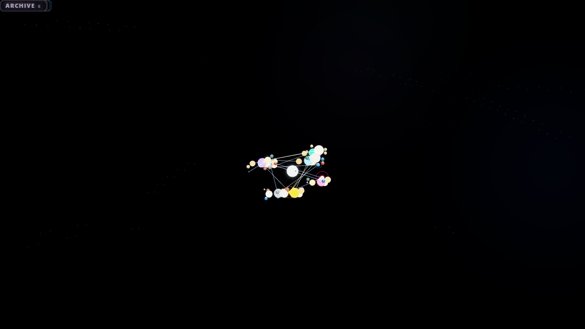

# Kosmos-Oden

Explore an Obsidian vault as a 3D sky, search notes by words or meaning, and let an AI assistant read folders you choose. Your notes stay ordinary Markdown files.

**[Download the plugin ZIP for 0.9.5-alpha.4](https://github.com/Odenknight/Kosmos-Oden/releases/download/kosmos-oden-0.9.5-alpha.4/kosmos-oden-0.9.5-alpha.4.zip)** · [Standalone offline viewer](https://github.com/Odenknight/Kosmos-Oden/releases/download/kosmos-oden-0.9.5-alpha.4/kosmos-oden-stand-alone.html) · [Release files and checksums](https://github.com/Odenknight/Kosmos-Oden/releases/tag/kosmos-oden-0.9.5-alpha.4)

Plugin ZIP SHA-256: `1042043ba5f3cda0c7577fa8e97380d76544806b9b735edaedd4dfe2c4bcee10`

## Install and start

1. Close Obsidian. Extract the ZIP and copy the files inside `kosmos-oden/` into `<vault>/.obsidian/plugins/kosmos-oden/`. On upgrade, keep your existing `data.json`.
2. Open Obsidian 1.13.0 or newer, enable **Kosmos-Oden** in **Settings → Community plugins**, and run **Open Kosmos-Oden** from the command palette.
3. For search alone, open **Search my notes**. A fresh **Personal Notes** profile starts with sharing off and no shared folders.

For the standalone viewer, open the downloaded HTML in a browser and select **Open Knowledge Folder**. It works offline without Obsidian or a source build.

## Connect an assistant at home

On **desktop Obsidian**, open **Connect my AI**, select a folder to share and keep the **Agent sensitivity ceiling** at **Internal** for ordinary household notes. The ceiling filters notes that have a sensitivity label. **Unlabeled notes in a shared folder are readable even at Public.** To share only public material, choose a folder containing only those notes and add private subfolders to **Never share**. Keep **Localhost only** when the assistant runs on this computer.

Press **Connect** to create the device bearer token, then **Copy configuration** for your assistant. The six Personal Notes tools are read-only. A cloud assistant receives the notes it reads. The desktop listener runs while Obsidian is open. The plugin also supports mobile viewing. Device-specific limits and manual trials are listed in the [alpha test record](docs/v0.9.5/ALPHA-TEST.md).

## Guides

| To do this | Open |
| --- | --- |
| Install, upgrade or check the download | [Alpha installation](docs/v0.9.5/ALPHA-INSTALL.md) |
| Explore the sky, import notes or configure a governed vault | [User guide](USER-GUIDE.md) |
| Choose folders, exclusions and access levels | [Personal Notes](docs/PERSONAL-NOTES.md) |
| Set up search by meaning or check ranking evidence | [Semantic search](docs/v0.9.5/SEMANTIC-SEARCH.md) |
| Configure a client or inspect the read-only tools | [Agent API reference](AGENT-API.md) |
| Audit the design or build from source | [Technical reference](TECHNICAL_README.md) · [Contributor setup](CONTRIBUTING.md) |

## What the alpha has demonstrated

Alpha.4 uses GKOS-Engine 2.5.1 and includes the Librarian, Map of Content generation and optional semantic search. On a 542-note evaluation corpus the Librarian ranked the expected note first for 39 of 44 questions. One incorrect answer received a strong confidence label. On 28 public Obsidian Help pages, the semantic worker ranked the reference page first on 8 of 16 questions and in the top five on 14. This measures semantic ranking before the Librarian combines evidence. Desktop and mobile Chromium, Firefox and WebKit test results, the outstanding visual snapshot difference and pending trials are recorded in the [alpha test record](docs/v0.9.5/ALPHA-TEST.md), [known limitations](docs/v0.9.5/KNOWN-LIMITATIONS.md) and [changelog](CHANGELOG.md).

## Source access and licensing

The compiled plugin and standalone viewer are public downloads. Rebuilding requires Git access to the **private GKOS-Engine** repository at the commit pinned in this repository's lockfile. Engine supplies the Personal Notes access policy, query service and shared graph logic. A public checkout alone cannot independently audit those implementations. [Contributor setup](CONTRIBUTING.md)

Project-authored software is Apache-2.0. Project-authored documentation and original graphics are CC BY 4.0. Third-party assets retain their own terms. Kosmos-Oden is an independent fork of H4R7W16/vault-kosmos. [Licensing by artifact](LICENSING.md) · [Third-party notices](THIRD-PARTY-NOTICES.md) · [Acknowledgments](ACKNOWLEDGMENTS.md)
